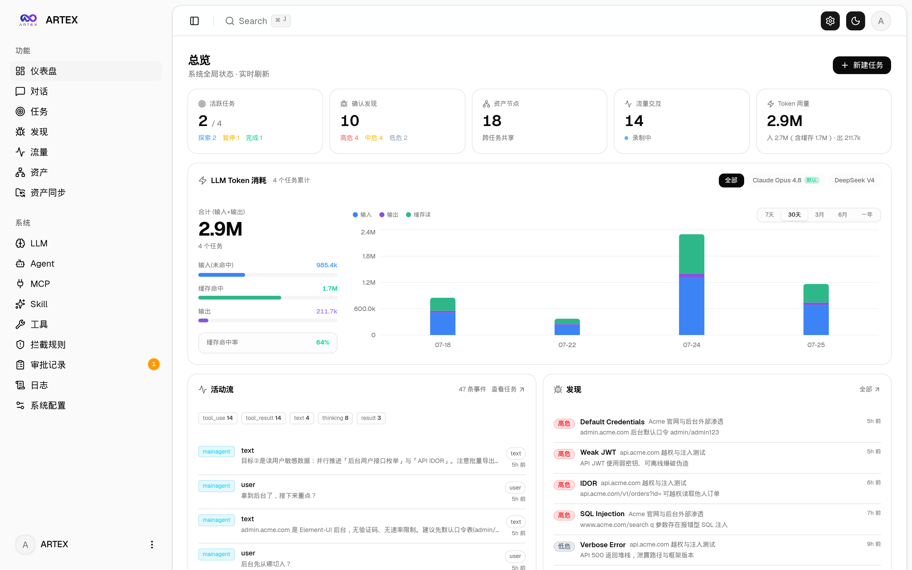

<div align="center">

# ARTEX

Autonomous security-research agent: a Go backend, a Next.js console, and a DeFi review skill that turns a Solidity repo or a pinned contract into scoped, evidence-gated findings.

[](LICENSE)

</div>

<p align="center">
  
</p>

This tree is a self-hosted checkout of [Autumn-27/ARTEX](https://github.com/Autumn-27/ARTEX) with a local DeFi detection pack: 43 detector cards, Foundry / Slither / Halmos adapters, and an evidence gate on `report_finding`. The [Chinese README](README.zh.md) keeps the full upstream architecture and release notes.

## What it does

ARTEX runs a planner and workers against an **asset graph** (companies, domains, services, endpoints, contracts, repositories) and a per-task **exploration graph** (goals, intents, facts, findings). Workers use Bash, files, network, MCP, and custom tools. In **DeFi protocol review** they also get `defi_analysis`: inventory, bounded local analyzers, verified-source fetch, deployment snapshots, and structured evidence.

A finding is not a Slither alert. DeFi `report_finding` needs a validated `confirmed` evidence record from the same task, operator approval, and a second validation before write. A claim about a live deployment must bind tested source to that contract’s verified runtime at a pinned block.

## Quick start

```bash
git clone https://github.com/Mx0FFFF/artex-for-defi.git
cd artex-for-defi
install -m 600 .env.example .env
# set a unique POSTGRES_PASSWORD in .env
docker compose up -d --build
# http://127.0.0.1:8787  — first visit is /setup
```

Compose builds the UI and backend, PostgreSQL, Foundry, Slither, and a Solidity compiler. `skills/` and `data/` are bind-mounted. LLM keys (`ANTHROPIC_API_KEY` or `OPENAI_API_KEY`) can live in `.env` or in **System → LLM**. Optional `RPC_URL` is a read-only HTTPS endpoint for pinned-block DeFi work.

`./install.sh` can do the same with a guided Docker or local binary install.

## DeFi review

The New task form defaults to **DeFi protocol review**. Give an HTTPS Solidity repository and revision (commit SHA preferred), or an EIP-155 chain ID plus contract address. Uploads work too. **Custom task** is the general flow.

| Piece | Role |
| --- | --- |
| `skills/defi-audit` | Skill prompt, 43 detector cards, 71 source records |
| `catalog.py` / `inventory.py` | Select cards; extract entry points and state |
| `run_analysis.py` | Bounded Forge, Slither, Halmos runs with receipts |
| `verified-source-fetch`, `deployment-snapshot`, `deployment-bind` | One scoped contract, pinned block, exact code match |
| `evidence.py` / `review_ledger.py` | Structured evidence and coverage bookkeeping |

```bash
python3 skills/defi-audit/scripts/catalog.py tags
python3 skills/defi-audit/scripts/catalog.py select --track evm --protocol vault --feature donations --format json --output /tmp/selection.json
```

Fixed script actions and the final evidence validator use Linux Landlock and seccomp. Ordinary Bash and other configured agent tools are **outside** that sandbox. Untrusted repositories belong in a separate environment without application credentials.

The [integration note](docs/defi-pack-integration.md) and [Royco Dawn pilot](docs/defi-pilot-royco-dawn.md) record how the pack is wired and what a real run actually produced. The project has not published independently measured detection accuracy. A run that dies in compile is incomplete, even with an empty findings list.

## Build a single binary

Node.js 22 for the static frontend (same as Docker/releases):

```bash
cd web && npm ci && npm run build:static && cd ..
cp -r web/out server/webui/dist
CGO_ENABLED=0 go build -tags embedui -o artex ./cmd/artex
./start.sh
```

Default listen: app `127.0.0.1:8787`, traffic recorder `127.0.0.1:8788`. Keep `:8787` off the public internet; use SSH, VPN, or a locked-down reverse proxy.

## Configuration

| Item | Where |
| --- | --- |
| Postgres | `.env` `POSTGRES_*` or `ARTEX_PG_DSN` / `config.json` |
| LLM | env keys or **System → LLM** |
| Skills | `skills/` (bind-mounted in Compose) |
| Data | `data/` (JWT, SQLite sidecars, task workdirs) — not in git |

Copy `config.example.json` → `config.json` only for a non-Compose binary install. Never commit `config.json`, `.env`, `jwt.key`, or `data/`.

## Development

```bash
./dev.sh          # backend :8787, proxy :8788, Next :5173
go test ./...
```

Frontend mock (no real targets): `cd web && NEXT_PUBLIC_MOCK=1 npm run dev`.

## What is not in this repository

Runtime secrets and operator data stay on the machine:

- `.env`, `openrouter_key`, `jwt.key`, `config.json`
- `data/` (task checkouts, JWT, local DBs)
- `review/`, `security_prompt.txt`, the original DeFi research zip
- `web/node_modules`, `web/out`, `dist/`, compiled `artex`

```bash
python3 scripts/check-private-paths.py
```

CI runs that path check and Gitleaks 8.24.3 over full history.

## License

[GNU AGPL-3.0](LICENSE). Network use of a modified version requires corresponding source under the same license.

Upstream login terms also restrict the software to personal learning and isolated technical verification, and they prohibit scanning or attacking systems you are not authorized to test. You are responsible for the law that applies to your work. Software is **AS IS**, without warranty. Full original terms: [README.zh.md](README.zh.md#许可与免责声明).

## Credits

- Upstream: [Autumn-27/ARTEX](https://github.com/Autumn-27/ARTEX)
- Agent SDK: [norma](https://github.com/Autumn-27/norma) (Apache-2.0 in `norma/LICENSE`)
- Context compression: [acp-kernel](https://github.com/ranxianglei/acp-kernel)

Issues: [Mx0FFFF/artex-for-defi](https://github.com/Mx0FFFF/artex-for-defi/issues)
